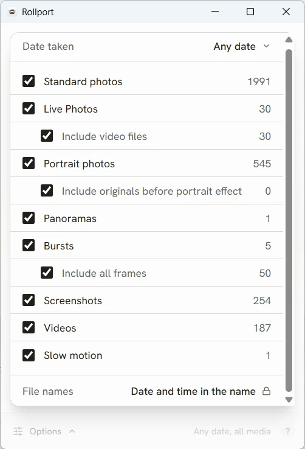

<p align="center">
  <picture>
    <source media="(prefers-color-scheme: dark)" srcset="docs/mark-dark.svg">
    
  </picture>
</p>

<h1 align="center">Rollport</h1>

<p align="center">
  <a href="README.md">English</a>
  &nbsp;&nbsp;|&nbsp;&nbsp;
  <a href="README.ko.md">한국어</a>
</p>

<p align="center">
  iPhone의 사진과 동영상을 USB로 가져오고, 복사할 항목과 위치를 선택하며,<br>
  누락된 메타데이터를 채우고, iPhone에서는 아무것도 삭제하지 않습니다.
</p>

<p align="center">
  <a href="https://dont-do-it-now.github.io/rollport/">웹사이트</a>
  &nbsp;&nbsp;
  <a href="https://dont-do-it-now.github.io/rollport/download">다운로드</a>
  &nbsp;&nbsp;
  <a href="https://dont-do-it-now.github.io/rollport/help">도움말</a>
</p>

<div align="center" style="font-size: 0; line-height: 0;">
  <span style="display: inline-block; width: 62%; vertical-align: top;">
    <picture>
      <source media="(prefers-color-scheme: dark)" srcset="docs/rollport-dark.webp">
      
    </picture>
  </span><span style="display: inline-block; width: 36%; margin-top: 5.5%; vertical-align: top;">
    
  </span>
</div>

## 주요 기능

- 이전 파일을 삭제하거나 이동한 뒤에도 새 사진과 동영상만 복사
- HEIC, ProRAW, Live Photo, 동영상, GIF, 카메라 RAW 등 원본 파일을 변환 없이 보존
- 날짜가 포함된 파일 이름, 연/월 폴더 또는 사용자 지정 패턴으로 정렬
- iPhone에서 USB로 이미지와 동영상을 직접 가져오기
- 일반 사진, Live Photo, 인물 사진, 파노라마, 연사 사진, 스크린샷, 동영상, 슬로 모션 동영상 분류
- Live Photo 동영상, 인물 사진 원본, 모든 연사 프레임을 선택적으로 포함
- 정확한 날짜 범위 선택, 특정 미디어 유형 제외, 지원하는 각 미디어 유형의 개수 표시
- 대상 폴더와 사용자 지정 파일 이름 형식 선택(날짜 기반 하위 폴더 포함)
- 새 파일 여부를 판단하기 전에 SQLite 라이브러리와 실제 대상 폴더를 대조
- iPhone 라이브러리에서 누락된 위치, 카메라/렌즈, 제목/설명 메타데이터 채우기
- 기존 대상 폴더의 메타데이터와 iPhone의 어떤 항목도 삭제하지 않음
- 언제든 중지하고 나중에 계속할 수 있으며, 가져오는 중 연결이 끊겨도 데이터 손실 없음
- iPhone별 폴더를 기억하며, 창에 폴더를 끌어다 놓아 전환 가능
- 가져오기 실패를 표시하고 예기치 않은 종료 정보를 다음 실행에 기록
- 키보드: <kbd>⌘</kbd>/<kbd>Ctrl</kbd>+<kbd>Enter</kbd> 가져오기, <kbd>⌘</kbd>/<kbd>Ctrl</kbd>+<kbd>.</kbd> 중지,
  <kbd>⌘</kbd>/<kbd>Ctrl</kbd>+<kbd>+</kbd>/<kbd>−</kbd>/<kbd>0</kbd> 확대/축소, <kbd>⌘</kbd><kbd>?</kbd> 또는 <kbd>F1</kbd> 도움말 열기
- Windows, macOS, Linux 지원
- 무료 오픈 소스, 계정 불필요, 오프라인 작동

Rollport의 모든 기능은 [도움말](https://dont-do-it-now.github.io/rollport/help)에서 확인할 수 있습니다.

## 기능 상세

### 미디어 분류

Rollport는 iPhone의 미디어 라이브러리와 USB로 노출된 파일을 읽은 뒤,
개수를 세거나 가져오기 전에 서로 대조합니다. 이를 통해 일반 사진, Live Photo와
동영상 구성 요소, 인물 사진과 원본, 파노라마, 연사 사진과 프레임, 스크린샷,
동영상, 슬로 모션 동영상을 구분합니다. 날짜 필터와 유형 체크박스는 이미지와
동영상 모두에 적용됩니다.

### 대상 폴더와 파일 이름

쓰기 가능한 로컬 또는 네트워크 폴더를 선택한 다음 기본 제공 파일 이름 형식을
고르거나 원하는 패턴을 입력할 수 있습니다. Rollport는 라이브러리 데이터베이스와
폴더에 실제로 존재하는 파일을 비교하므로, 데이터베이스가 최신 상태가 아니어도
기존 파일을 다시 복사하지 않습니다. 형식을 변경하면 이후 가져오기에 적용되며,
기존 파일의 이름은 변경하지 않습니다.

### 메타데이터 보완

이 기능을 켜면 Rollport가 iPhone 라이브러리에서 누락된 위치, 카메라와 렌즈,
제목/설명 정보를 채웁니다. 기존 값은 유지하며 메타데이터를 삭제하는 옵션은
없습니다. 파일 업데이트에는 Rollport와 별도의 라이선스가 적용되는 ExifTool
유틸리티가 함께 사용됩니다.

### 안전한 가져오기

가져오기는 중지한 뒤 나중에 계속할 수 있습니다. 이미 복사된 파일은 대상 폴더에
남고 iPhone은 변경되지 않으며, 실패한 항목을 표시하면서 나머지 가져오기는
계속됩니다. 애플리케이션이 예기치 않게 종료되면 다음 실행 때 기록된 오류 상세
정보가 표시됩니다.

## 다운로드

[다운로드 페이지](https://dont-do-it-now.github.io/rollport/download)에서 최신
버전을 받거나 아래 파일을 직접 선택하세요.

| Windows                    | macOS      | Linux                |
| -------------------------- | ---------- | -------------------- |
| [설치 프로그램][setup.exe] | [DMG][dmg] | [AppImage][appimage] |
| [포터블][portable.exe]     |            | [DEB][deb]           |
|                            |            | [RPM][rpm]           |

[setup.exe]: https://github.com/Dont-Do-it-Now/rollport/releases/latest/download/Rollport-setup.exe
[portable.exe]: https://github.com/Dont-Do-it-Now/rollport/releases/latest/download/Rollport.exe
[dmg]: https://github.com/Dont-Do-it-Now/rollport/releases/latest/download/Rollport.dmg
[appimage]: https://github.com/Dont-Do-it-Now/rollport/releases/latest/download/Rollport.AppImage
[deb]: https://github.com/Dont-Do-it-Now/rollport/releases/latest/download/Rollport.deb
[rpm]: https://github.com/Dont-Do-it-Now/rollport/releases/latest/download/Rollport.rpm

이전 버전은 [릴리스 페이지](https://github.com/Dont-Do-it-Now/rollport/releases)에서
확인할 수 있습니다.

- macOS: Apple silicon과 Intel용 통합 DMG를 제공합니다. 앱에 공증이 되어 있지
  않아 처음 실행할 때 macOS가 차단합니다. 시스템 설정 → 개인정보 보호 및 보안에서
  허용하세요.
- Windows: [Apple Devices](https://apps.microsoft.com/detail/9np83lwlpz9k)(Microsoft
  Store) 또는 iTunes가 필요합니다. 앱에 서명이 되어 있지 않아 SmartScreen 경고가
  표시됩니다. 자세히 보기 → 실행을 선택하세요.
- Linux: `usbmuxd`가 필요합니다(`apt install usbmuxd` / `dnf install usbmuxd`).
  먼저 AppImage를 실행 가능하게 만드세요: `chmod +x Rollport.AppImage`.

iPhone의 잠금을 해제해야 합니다. 처음 연결할 때 iPhone에서 이 컴퓨터를 신뢰하도록
허용하세요. 본인의 컴퓨터 또는 신뢰할 수 있는 컴퓨터만 허용해야 합니다. 시스템별
모든 단계는 [시작하기](https://dont-do-it-now.github.io/rollport/help/getting-started)에서
확인할 수 있습니다.

Rollport는 iPhone에 있는 항목을 가져옵니다. iPhone 저장 공간 최적화가 켜져 있으면
많은 원본이 iCloud에만 있을 수 있으므로, 먼저 [iPhone에 다운로드](https://dont-do-it-now.github.io/rollport/help/troubleshooting#icloud)하세요.

메타데이터 보완 기능은 ExifTool 유틸리티를 함께 사용합니다. 이미 있는 메타데이터는
삭제하지 않고 누락된 값만 채웁니다. ExifTool은 별도의 서드파티 구성 요소이며,
고지 및 라이선스 파일은 `src-tauri/resources/exiftool/`에 있습니다.

## 환경 변수

Rollport는 아래 변수를 읽고, 필요한 경우 첫 번째 변수만 설정합니다. 직접 설정한
값이 항상 우선합니다.

| 변수                                                                | Rollport의 동작                                                                                                                                                      |
| ------------------------------------------------------------------- | -------------------------------------------------------------------------------------------------------------------------------------------------------------------- |
| `__NV_DISABLE_EXPLICIT_SYNC`                                        | Linux: NVIDIA 드라이버가 로드되어 있고 직접 설정하지 않은 경우 `1`로 설정합니다. Wayland 충돌("Error 71")을 막고 GPU 렌더링을 유지합니다. 끄려면 `0`으로 설정하세요. |
| `WEBKIT_DISABLE_DMABUF_RENDERER`, `WEBKIT_DISABLE_COMPOSITING_MODE` | Linux: Rollport가 설정하지 않습니다. 직접 설정하면(값이 `0`이 아닌 경우) WebKitGTK가 GPU 없이 렌더링하며, 충돌을 막기 위해 화면 전환 애니메이션이 변경됩니다.        |
| `APPIMAGE`                                                          | Linux: AppImage가 설정합니다. AppImage의 오래된 WebKitGTK가 화면 전환 애니메이션에서 충돌하므로 Rollport가 애니메이션 없이 화면을 전환합니다.                        |
| `USBMUXD_SOCKET_ADDRESS`                                            | usbmuxd가 수신하는 위치: 소켓 경로 또는 `host:port`. 기본값은 `/var/run/usbmuxd`이며 Windows에서는 `127.0.0.1:27015`입니다.                                          |

## 출처

Rollport는 [artificiadrian](https://github.com/artificiadrian/rollport)의 기존
오픈 소스 프로젝트를 기반으로 합니다. 이 포크는 기존 USB 가져오기 흐름을 유지하며,
미디어 분류, 실제 폴더 대조, 대상 파일 이름 제어, 메타데이터 보완, 충돌 보고 기능을
추가합니다.

## 빌드

필요한 도구: [Rust](https://rustup.rs), [Node.js](https://nodejs.org) ≥ 22.18,
[pnpm](https://pnpm.io/installation), [Tauri 사전 요구 사항](https://v2.tauri.app/start/prerequisites/).

```sh
pnpm install
pnpm tauri dev
```

`pnpm tauri build`는 설치 프로그램을 빌드합니다. 나머지 내용은
[한국어 기여 안내](CONTRIBUTING.ko.md)를 참고하세요.

Windows에서는 `deploy.bat`가 릴리스 실행 파일을 빌드하고 빌드가 성공하면 실행합니다.

## 라이선스

Rollport 소스 코드는 MIT License를 따릅니다. 기존 저작권 고지는 [LICENSE](LICENSE)에
그대로 남아 있으며, [한국어 참고 번역](LICENSE.ko.md)도 제공합니다. ExifTool은 자체
GPL 또는 Perl Artistic License가 적용되는 별도 유틸리티로 포함되며, Rollport의 MIT
License는 ExifTool에 적용되지 않습니다.

---

iPhone은 미국 및 기타 국가와 지역에서 Apple Inc.의 상표입니다. Rollport는 Apple과
제휴하거나 Apple의 보증을 받지 않습니다.
