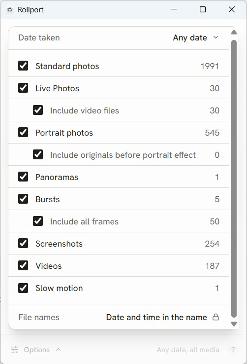

<p align="center">
  <picture>
    <source media="(prefers-color-scheme: dark)" srcset="docs/mark-dark.svg">
    
  </picture>
</p>

<h1 align="center">Rollport</h1>

<p align="center">
  <a href="README.md">English</a>
  &nbsp;&nbsp;|&nbsp;&nbsp;
  <a href="README.ko.md">한국어</a>
</p>

<p align="center">
  Import photos and videos from your iPhone over USB, choose what to copy and where it goes,<br>
  fill missing metadata, and never delete anything from the phone.
</p>

<p align="center">
  <a href="https://dont-do-it-now.github.io/rollport/">Website</a>
  &nbsp;&nbsp;
  <a href="https://dont-do-it-now.github.io/rollport/download">Download</a>
  &nbsp;&nbsp;
  <a href="https://dont-do-it-now.github.io/rollport/help">Help</a>
</p>

<div align="center">
  <picture>
    <source media="(prefers-color-scheme: dark)" srcset="docs/rollport-dark.webp">
    
  </picture>
</div>

## Features

- Copies only new photos and videos, even after you delete or move old ones
- Preserves original files such as HEIC, ProRAW, Live Photos, video, GIFs, and camera RAW without conversion
- Sorts files by date using dated filenames, year/month folders, or a custom pattern
- Imports both images and videos directly from the iPhone over USB
- Classifies standard photos, Live Photos, portrait photos, panoramas, bursts, screenshots, videos, and slow-motion videos
- Includes optional Live Photo videos, portrait originals, and all burst frames
- Selects an exact date range, leaves out selected media types, and shows counts for every supported media type
- Chooses the destination folder and a custom filename layout, including date-based subfolders
- Reconciles the SQLite library with the actual destination folder before deciding what is new
- Fills missing location, camera/lens, and title/description metadata from the iPhone library
- Never deletes existing destination metadata or anything from the iPhone
- Stops at any time and continues later; unplugging during an import loses nothing
- Remembers each iPhone's folder; drop a folder on the window to switch
- Shows import failures and records unexpected exits for the next launch
- Keyboard: <kbd>⌘</kbd>/<kbd>Ctrl</kbd>+<kbd>Enter</kbd> imports, <kbd>⌘</kbd>/<kbd>Ctrl</kbd>+<kbd>.</kbd> stops,
  <kbd>⌘</kbd>/<kbd>Ctrl</kbd>+<kbd>+</kbd>/<kbd>−</kbd>/<kbd>0</kbd> zooms, <kbd>⌘</kbd><kbd>?</kbd> or <kbd>F1</kbd> opens help
- Windows, macOS and Linux
- Free and open source, no account, works offline

See the [help](https://dont-do-it-now.github.io/rollport/help) for everything
Rollport does.

## Feature details

### Media classification

Rollport reads the iPhone's media library and the files exposed over USB, then
matches them before counting or importing. This lets it distinguish standard
photos, Live Photos and their video components, portrait photos and originals,
panoramas, bursts and their frames, screenshots, videos, and slow-motion
videos. The date filter and type checkboxes are applied to both images and
videos.

### Destination and filenames

Choose any writable local or network folder, then select a built-in filename
layout or enter a pattern of your own. Rollport compares the library database
with the files physically present in that folder, so an existing file is not
copied again just because the database is out of date. Changing the layout
affects future imports; existing files are not renamed.

### Metadata enrichment

When enabled, Rollport fills missing location, camera and lens, and
title/description values from the iPhone library. Existing values are kept,
and there is no metadata deletion option. The bundled ExifTool utility is used
for file updates and is licensed separately from Rollport.

### Safe imports

Imports can be stopped and continued later. Files already copied remain in the
destination, the iPhone is never modified, and failures are reported without
discarding the rest of the import. If the application exits unexpectedly, the
next launch shows the recorded error details.

## Download

Get the newest version from the
[download page](https://dont-do-it-now.github.io/rollport/download), or pick a
file here:

| Windows                  | macOS      | Linux                |
| ------------------------ | ---------- | -------------------- |
| [Installer][setup.exe]   | [DMG][dmg] | [AppImage][appimage] |
| [Portable][portable.exe] |            | [DEB][deb]           |
|                          |            | [RPM][rpm]           |

[setup.exe]: https://github.com/Dont-Do-it-Now/rollport/releases/latest/download/Rollport-setup.exe
[portable.exe]: https://github.com/Dont-Do-it-Now/rollport/releases/latest/download/Rollport.exe
[dmg]: https://github.com/Dont-Do-it-Now/rollport/releases/latest/download/Rollport.dmg
[appimage]: https://github.com/Dont-Do-it-Now/rollport/releases/latest/download/Rollport.AppImage
[deb]: https://github.com/Dont-Do-it-Now/rollport/releases/latest/download/Rollport.deb
[rpm]: https://github.com/Dont-Do-it-Now/rollport/releases/latest/download/Rollport.rpm

Older versions are on the
[releases page](https://github.com/Dont-Do-it-Now/rollport/releases).

- macOS: one DMG for Apple silicon and Intel. The app isn't notarized, so
  macOS blocks it the first time. Allow it in
  System Settings → Privacy & Security.
- Windows: requires [Apple Devices](https://apps.microsoft.com/detail/9np83lwlpz9k)
  (Microsoft Store) or iTunes. The app isn't signed, so SmartScreen warns
  you: More info → Run anyway.
- Linux: requires `usbmuxd` (`apt install usbmuxd` / `dnf install usbmuxd`).
  Make the AppImage runnable first: `chmod +x Rollport.AppImage`.

The iPhone has to be unlocked. The first time you connect it, tap Trust on the
phone. Trust only your own computer, or one you know. [Get started](https://dont-do-it-now.github.io/rollport/help/getting-started)
has every step for each system.

Rollport imports what is on the iPhone. With Optimize iPhone Storage on, many
originals are only in iCloud;
[download them to the iPhone first](https://dont-do-it-now.github.io/rollport/help/troubleshooting#icloud).

Metadata enrichment uses the bundled ExifTool utility. It only fills missing
values and never removes metadata that is already present. ExifTool is a
separate third-party component; see its notice and license files under
`src-tauri/resources/exiftool/`.

## Environment variables

Rollport reads these, and sets only the first. A value you set yourself always
wins.

| Variable                                                            | What Rollport does with it                                                                                                                                                       |
| ------------------------------------------------------------------- | -------------------------------------------------------------------------------------------------------------------------------------------------------------------------------- |
| `__NV_DISABLE_EXPLICIT_SYNC`                                        | Linux: set to `1` when the NVIDIA driver is loaded and you have not set it. This stops WebKitGTK's Wayland crash ("Error 71") and keeps the GPU drawing. Set `0` to turn it off. |
| `WEBKIT_DISABLE_DMABUF_RENDERER`, `WEBKIT_DISABLE_COMPOSITING_MODE` | Linux: never set by Rollport. If you set one (to anything but `0`), WebKitGTK draws without the GPU, and Rollport changes screens without animation, which would crash it.       |
| `APPIMAGE`                                                          | Linux: set by the AppImage. Rollport then changes screens without animation, because the AppImage's older WebKitGTK crashes on it.                                               |
| `USBMUXD_SOCKET_ADDRESS`                                            | Where usbmuxd listens: a socket path or `host:port`. The default is `/var/run/usbmuxd`, or `127.0.0.1:27015` on Windows.                                                         |

## Origin

Rollport is based on the original open-source project by
[artificiadrian](https://github.com/artificiadrian/rollport). This fork keeps
the original USB import flow and adds media classification, physical-folder
reconciliation, destination naming controls, metadata enrichment, and crash
reporting.

## Building

Requirements: [Rust](https://rustup.rs), [Node.js](https://nodejs.org) ≥ 22.18,
[pnpm](https://pnpm.io/installation), and the
[Tauri prerequisites](https://v2.tauri.app/start/prerequisites/).

```sh
pnpm install
pnpm tauri dev
```

`pnpm tauri build` builds the installer. See
[CONTRIBUTING.md](CONTRIBUTING.md) for the rest. See the
[Korean contribution guide](CONTRIBUTING.ko.md) if you prefer Korean.

On Windows, `deploy.bat` builds the release executable and launches it after a
successful build.

## Licence

Rollport source code is available under the MIT License. The original
copyright notice is retained in [LICENSE](LICENSE). A Korean reference
translation is available in [LICENSE.ko.md](LICENSE.ko.md). ExifTool is bundled as a
separate utility under its own GPL or Perl Artistic License; Rollport's MIT
license does not apply to it.

---

iPhone is a trademark of Apple Inc., registered in the U.S. and other
countries and regions. Rollport is not affiliated with or endorsed by Apple.
